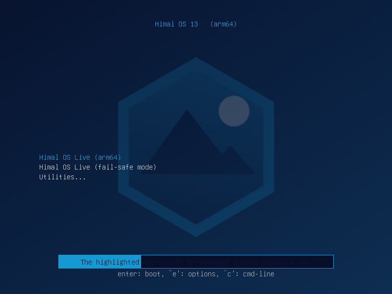
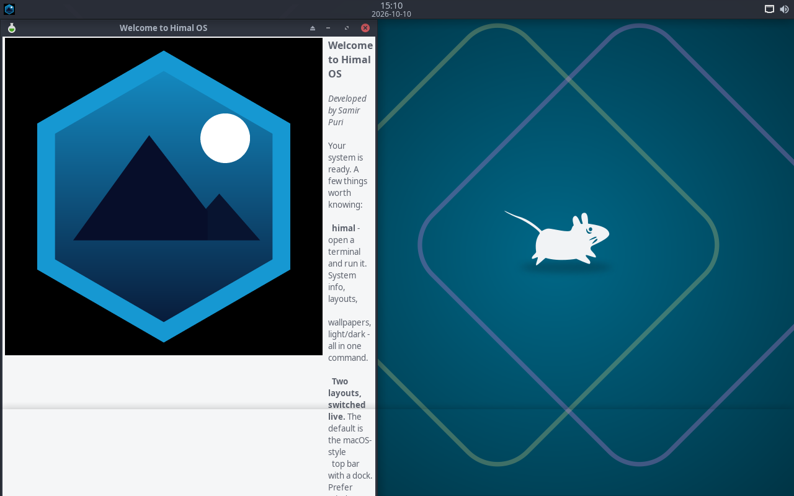

<p align="center">
  
</p>

<h1 align="center">Himal OS</h1>

<p align="center">
  <strong>Power by People, Inspired by Nepal</strong><br>
  A Debian-based operating system for Apple Silicon, rebuilt and extended.<br>
  <sub>Build by <strong>Samir Puri</strong></sub>
</p>

<p align="center">
  
  
  
  
  
</p>

---

## Download

The ready-to-boot image is published as a GitHub Release.

**[Download Himal OS 13 →](https://github.com/samirpuri204/himal-os/releases/tag/v13.0.0)**

GitHub rejects release assets of 2 GiB or larger, so the 2.68 GiB image is split
into three parts. Download all three, then reassemble and verify:

```bash
cat Himal-OS-13-arm64-xfce.iso.part1of3 \
    Himal-OS-13-arm64-xfce.iso.part2of3 \
    Himal-OS-13-arm64-xfce.iso.part3of3 > Himal-OS-13-arm64-xfce.iso

shasum -a 256 Himal-OS-13-arm64-xfce.iso
# expected 0f2b52e98fd99c801e1c8b98792f4671da338f5d02362a7369a034278ccebbbe
```

| | |
|---|---|
| Release | [v13.0.0](https://github.com/samirpuri204/himal-os/releases/tag/v13.0.0) |
| Parts | 3 × 958,830,592 bytes |
| Reassembled size | 2,876,491,776 bytes (2.68 GiB) |
| SHA-256 | `0f2b52e98fd99c801e1c8b98792f4671da338f5d02362a7369a034278ccebbbe` |
| Architecture | arm64 (aarch64), UEFI |

The release also carries `SHA256SUMS.txt`, so you can verify the individual
parts with `shasum -a 256 -c SHA256SUMS.txt` before reassembling.

> **arm64 only.** This image runs on Apple Silicon and other arm64 machines. It
> will not run on x86 hardware or in an x86 virtual machine — an ARM CPU cannot
> execute x86 code, and the image contains no x86 binaries.

---

## Screenshots

Real captures from the built ISO, taken headlessly under QEMU with UEFI firmware:

| Boot menu | Desktop |
|---|---|
|  |  |
| The GRUB menu carries the Himal OS identity, not Debian's | Xfce with the macOS-style top panel and the first-run Welcome window |


---

## What this is

Himal OS keeps **Debian's tested Linux foundation** and adds its own desktop
components, configuration tools and Nepal-focused defaults.

It is built for **arm64**, so on Apple Silicon it runs **natively** through
Apple's Hypervisor framework rather than under CPU emulation — which is what
makes it fast on a modern Mac.

---

## Features

### Desktop

| Feature | What it does |
|---|---|
| **Dynamic Desktop** | Translucent panels, rounded corners, real window shadows, blur and smooth window fading — Picom plus a Himal GTK3 stylesheet |
| **Himal Launcher** | Application search, open windows, file browsing and power controls (lock, logout, suspend, restart, shut down) |
| **Control Center** | Quick settings for Wi-Fi, Bluetooth, dark mode, night light, brightness, volume, battery and performance |
| **Personalization Studio** | Themes, wallpapers, icon packs and desktop layouts, with macOS / Windows / Minimal presets |
| **System Dashboard** | Live CPU, memory, disk and network throughput, plus system information, storage, processes and updates |

### System

| Feature | What it does |
|---|---|
| **Security Center** | Firewall state, pending security updates, open ports, SSH hardening, fail2ban, auth logs, and a one-click full scan |
| **Recovery System** | System snapshots and rollback via Timeshift, plus guided repair for broken updates, package errors, networking, display config and panels |
| **Performance Mode** | Eco / Balanced / Performance through `power-profiles-daemon` — real hardware power management, not a cosmetic switch |
| **Universal App Hub** | One search across APT packages, Flatpak apps and AppImages, with the source shown before every install |
| **Nepal-first** | Nepali and English locales, `us,np` keyboard layouts, Devanagari fonts, Asia/Kathmandu timezone, and `himal calendar` printing the date in Nepali |
| **Safer defaults** | Automatic security updates, firewall enabled with deny-incoming, AppArmor, and confirmation before risky changes |

### One command for everything

```bash
himal                 # branded system information
himal features        # what makes this system different
himal control-center  # quick settings
himal studio          # personalization
himal dashboard       # system monitor
himal security        # security center
himal recovery        # snapshots and repair
himal performance     # Eco / Balanced / Performance
himal apphub          # APT + Flatpak + AppImage
himal layout windows  # switch to the Windows-style desktop
himal wallpaper dusk  # change wallpaper live
himal calendar        # the date, in Nepali
```

---

## Using it

### Requirements

- Apple Silicon Mac (M1 or later), or any arm64 machine
- ~3 GB free disk
- UTM, QEMU, or any hypervisor with arm64 + UEFI support

### Boot in UTM

1. Open UTM, click **+** to create a virtual machine
2. Choose **Virtualize** — *not* Emulate. This image is arm64, so it runs natively.
3. Operating system: pick any Linux/other arm64 option
4. Memory: **2048 MB** or more
5. Under **Drives**, add a **CD/DVD (ISO) Image** drive and select
   `Himal-OS-13-arm64-xfce.iso`
6. Ensure firmware is **UEFI** (the default for arm64)
7. Start the VM

The boot menu appears for 10 seconds; it boots automatically if you do nothing.
You will land on the Xfce desktop as the `himal` user.

### Boot in QEMU

```bash
qemu-system-aarch64 \
  -M virt -m 2048 -smp 2 \
  -bios /opt/homebrew/share/qemu/edk2-aarch64-code.fd \
  -device virtio-gpu-pci \
  -cdrom Himal-OS-13-arm64-xfce.iso
```

### First things to try

```bash
himal info            # see the branded system information
himal features        # the feature tour
himal layout windows  # switch the desktop layout live
himal studio          # change theme, wallpaper, icons, layout
```

---

## Building from source

See [docs/BUILDING.md](docs/BUILDING.md). In short:

```bash
docker run -d --privileged --platform linux/arm64 \
  --name himal-deb -v "$PWD/build:/build" debian:trixie sleep infinity

docker exec himal-deb bash -lc '
  apt-get update && apt-get install -y live-build debootstrap squashfs-tools \
    xorriso grub-efi-arm64-bin mtools dosfstools
  cd /build && lb build'
```

The `--privileged` flag is required: `live-build` mounts `/proc`, `/sys` and
`/dev/pts` inside its chroot, and Docker drops `CAP_SYS_ADMIN` by default.

`tools/` contains the generators that produce everything under
`build/config/includes.chroot/`, so the overlay is reproducible rather than
hand-maintained.

---

## Verified status

Honest accounting of what has been tested on real boots:

| Area | Status |
|---|---|
| ISO builds | **Verified** — completes every phase with no errors |
| UEFI boot, arm64 | **Verified** — `EFI/boot/bootaa64.efi` |
| GRUB boot menu | **Verified** — see the screenshot above |
| Desktop session | **Verified** — Xfce reaches the desktop |
| macOS-style panel | **Verified** — Himal menu button, centred clock, tray |
| First-run Welcome window | **Verified** |
| Nepal-first defaults | **Verified** in the image |
| Boot splash (Plymouth) | **Known issue** — theme is installed and selected, but the Plymouth distro hook excludes it from the initramfs. `build/config/includes.chroot/etc/initramfs-tools/hooks/himal-plymouth` is a fix that copies it explicitly; not yet rebuilt. |
| The eight Himal applications | **Unverified at runtime** — they compile cleanly and are present, but have not been executed |

---

## Development

**Developer:** Samir Puri

The Himal OS identity appears on the boot menu, the desktop wallpaper, the login
banner, the About window and in this repository — not scattered through every
menu label, by design.

---

## License and attribution

Himal OS is a derivative of **Debian GNU/Linux 13 (trixie)**, which is free
software distributed under the GNU General Public License.

- Debian's copyright notices are preserved.
- The full corresponding source for any distributed image is this repository,
  plus Debian's own archive.
- "Debian" is a trademark of Software in the Public Interest, Inc. Himal OS is
  not affiliated with or endorsed by the Debian Project.
- ReactOS-derived work from an earlier phase of this project is licensed
  GPLv2+; its notices are likewise preserved where applicable.

<p align="center"><sub>Build by <strong>Samir Puri</strong> — Power by People, Inspired by Nepal</sub></p>
